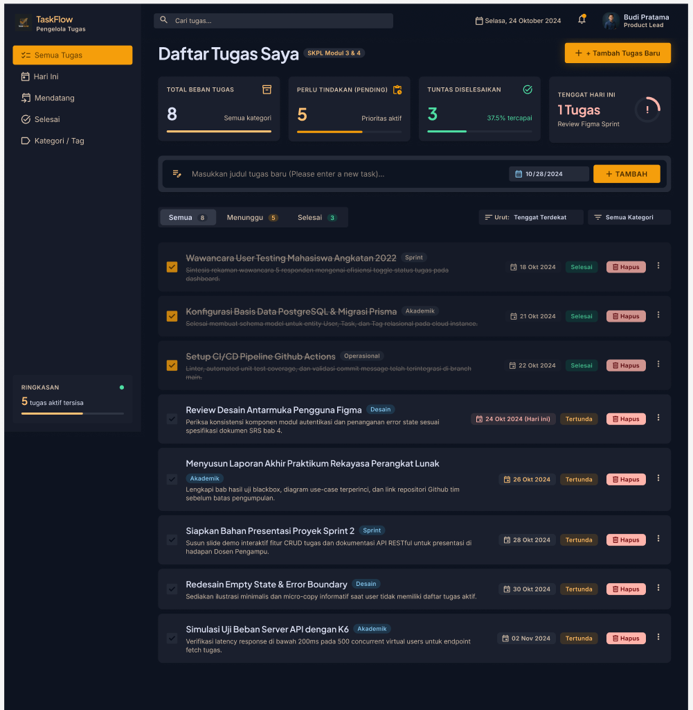

# TaskFlow: Pengembangan Aplikasi To-Do List Berbasis Web
Repositori ini berisi seluruh dokumen spesifikasi teknis, rancangan UI/UX, aturan keamanan, skrip database Supabase, dan implementasi kode Single Page Application (SPA) berbasis **Tailwind CSS** dan **Supabase**, yang diselaraskan 100% dengan **Desain Figma TaskFlow**.

---

## 🎨 Tampilan Desain Antarmuka (Figma TaskFlow)



Aplikasi mengusung tema **Dark Modern** dengan palet warna *Deep Slate/Navy*, aksen *Warm Amber / Gold* (`#F59E0B`), dan *Emerald Green* (`#4EDEA3`).

---

## 📁 Struktur Berkas Repositori

```text
├── PRD.md                 # Product Requirements Document (Identitas, CRUD, Skema Data & Kontrak QA)
├── STITCH_PROMPT.md       # Prompt Desain UI/UX Siap Pakai untuk Google Stitch
├── DESIGN.md              # Design System & Panduan Token Visual (Sesuai Desain Figma TaskFlow)
├── RULES.md               # AI Coding & Security Guardrails (Anti-XSS & Kredensial)
├── supabase_schema.sql    # Skrip PostgreSQL Supabase (Tabel tasks, RLS, CHECK & Dummy Data)
├── index.html             # Implementasi Lengkap Web Application Sesuai Desain Figma (SPA)
├── screenshot.png         # Tangkapan layar desain Figma resmi
└── README.md              # Dokumentasi & Petunjuk Penggunaan
```

---

## 🚀 Panduan Memulai Cepat

### 1. Setup Skema Database di Supabase
1. Buka [Supabase Dashboard](https://supabase.com/dashboard).
2. Buat proyek baru atau pilih proyek yang sudah ada.
3. Masuk ke menu **SQL Editor**, buka berkas [`supabase_schema.sql`](supabase_schema.sql), lalu salin seluruh kodenya dan klik **Run**.
4. Skrip ini akan membuat:
   - Tabel `public.tasks` dengan validasi constraint `CHECK`.
   - Mengaktifkan Row Level Security (RLS) dengan policy publik untuk demo.
   - Mengisi data tugas awal secara otomatis.

### 2. Konfigurasi Kredensial Frontend
Buka file [`index.html`](index.html), cari baris konfigurasi Supabase (sekitar baris 330):
```javascript
const SUPABASE_URL = "https://your-project-id.supabase.co";
const SUPABASE_ANON_KEY = "your-public-anon-key";
```
*Ganti dengan URL dan Anon Key publik dari menu Project Settings > API di Supabase.*
*(Catatan: Aplikasi tetap dapat berjalan secara mandiri dalam mode demo interaktif lokal / localStorage jika URL dikosongkan).*

### 3. Menjalankan Aplikasi
Cukup buka berkas `index.html` langsung menggunakan web browser apa pun (Google Chrome, Edge, Safari, Firefox), atau klik kanan dan pilih **Open with Live Server** di VS Code.

---

## 🛡️ Kepatuhan Standar Uji & Keamanan (Modul 5 SKPL)
* **TC-01 (Toggle Status Tugas):** Klik checkbox pada baris tugas mengubah status `Pending` ↔ `Completed` seketika (zero page reload).
* **TC-02 (Validasi Form Kosong):** Menolak penyimpanan saat field Judul kosong dan memunculkan peringatan *"Judul tugas tidak boleh kosong!"*.
* **SEC-01 (Anti-XSS Protection):** Seluruh input dirender aman menggunakan `.textContent` / sanitasi entitas HTML (`escapeHtml`).
* **SEC-02 (Credential Audit):** Tidak ada secret service role key yang terekspos di sisi klien.
